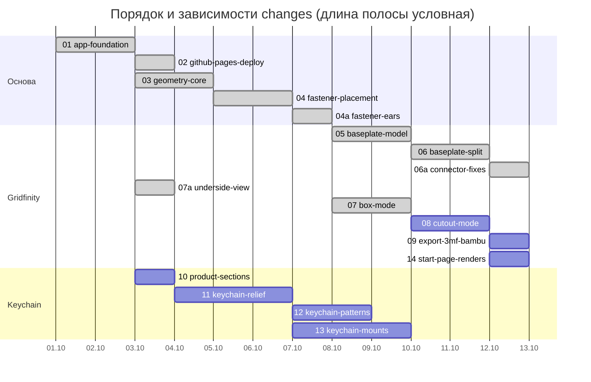

# Roadmap

Порядок работ = числовой префикс папки в `openspec/changes/`. Брать строго по возрастанию; зависимости указывают только на меньшие номера.

| # | Change | Depends on | Результат |
|---|--------|-----------|-----------|
| 01 | `01-app-foundation` | — | Tailwind, Tabler, структура компонентов, i18n en/ru, mm/inch, переключатель режимов |
| 02 | `02-github-pages-deploy` | 01 | CI и деплой на GitHub Pages (дальше каждая фича сразу видна онлайн) |
| 03 | `03-geometry-core` | 01 | Общая геометрия Gridfinity, дробные xy-юниты, настройки толщин |
| 04 | `04-fastener-placement` | 01, 03 | Винты и магниты: по краям, в каждой ячейке, вручную |
| 04a | `04a-fastener-ears` | 04 | Уши вокруг отверстий вместо сплошного пола, без ручной расстановки, правка подписей в tab |
| 05 | `05-baseplate-model` | 01, 03, 04 | Режим Baseplate на новой геометрии |
| 06 | `06-baseplate-split` | 05 | Разделение на части под стол, торцевые соединения |
| 06a | `06a-connector-fixes` | 06 | Ласточкин хвост на столе, отверстия под пруток филамента и глухие |
| 07 | `07-box-mode` | 01, 03, 04 | Box/Tray: wall, ledge, scoop |
| 07a | `07a-underside-view` | 01 | Камера проходит под плоскость XY, сетка и стол скрываются, подсветка снизу |
| 08 | `08-cutout-mode` | 07, 04 | Cutout: STL-импорт, прямоугольник, центровка |
| 09 | `09-export-3mf-bambu` | 05–08 | Экспорт 3MF, пресеты Bambu |
| 10 | `10-product-sections` | 01 | Разделы сайта Gridfinity Master / Keychain Master, маршруты, переключатель продуктов |
| 11 | `11-keychain-relief` | 10 | Keychain: растр → силуэт → рельеф, масштаб, подложка, STL |
| 12 | `12-keychain-patterns` | 11 | Keychain: источники высоты (в т.ч. яркость), профили, паттерны |
| 13 | `13-keychain-mounts` | 11 | Keychain: крепление под кольцо, редактор расстановки, две половинки, штифты |
| 14 | `14-start-page-renders` | 07, 08, 10 | Стартовая страница: векторные рендеры настоящих деталей 2×2 вместо схематичных SVG, готовятся на этапе сборки |

05–06 и 07–08 независимы друг от друга и могут идти в любом порядке.

10–13 — отдельная ветка (Keychain Master); 12 и 13 независимы друг от друга.
